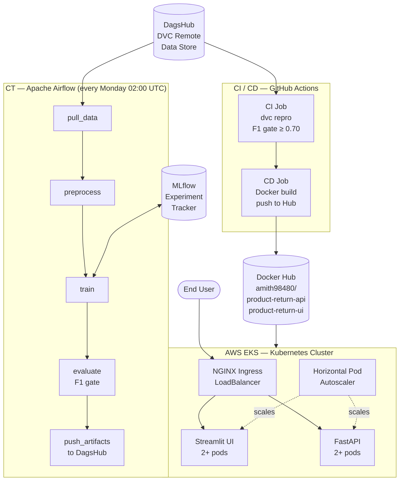
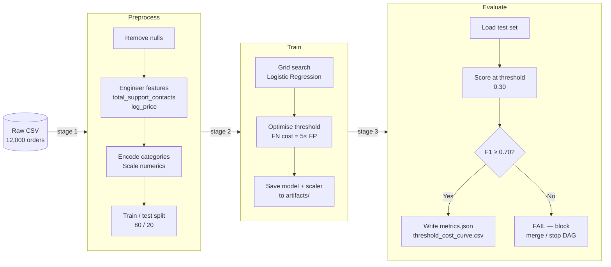
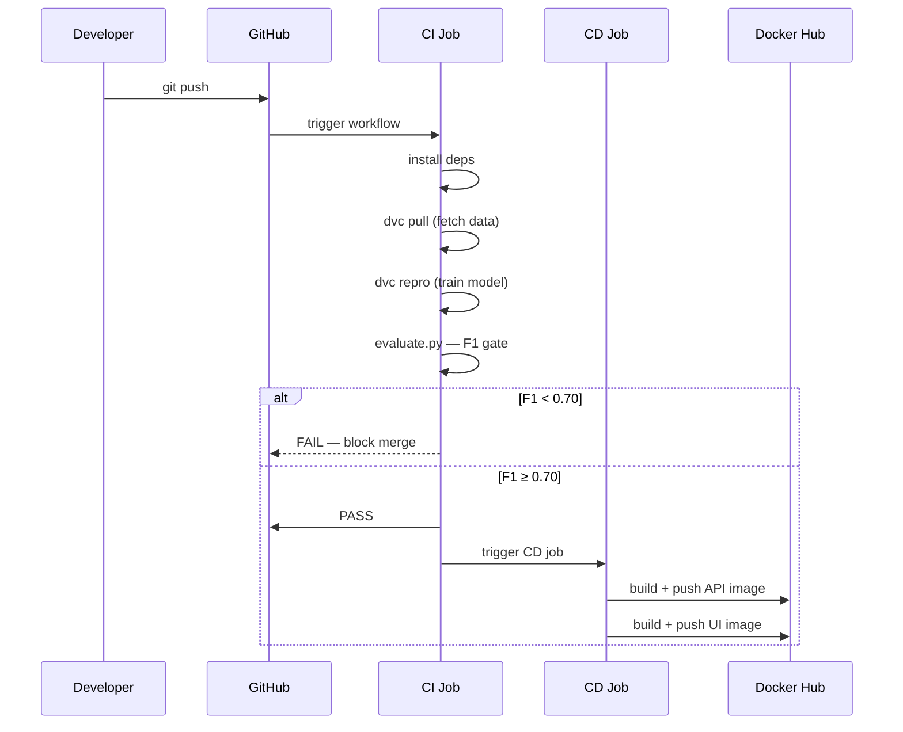
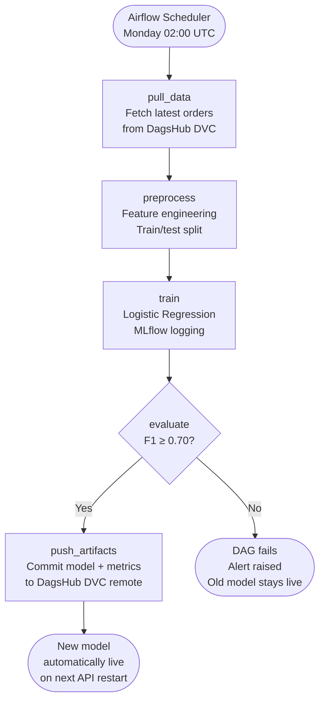
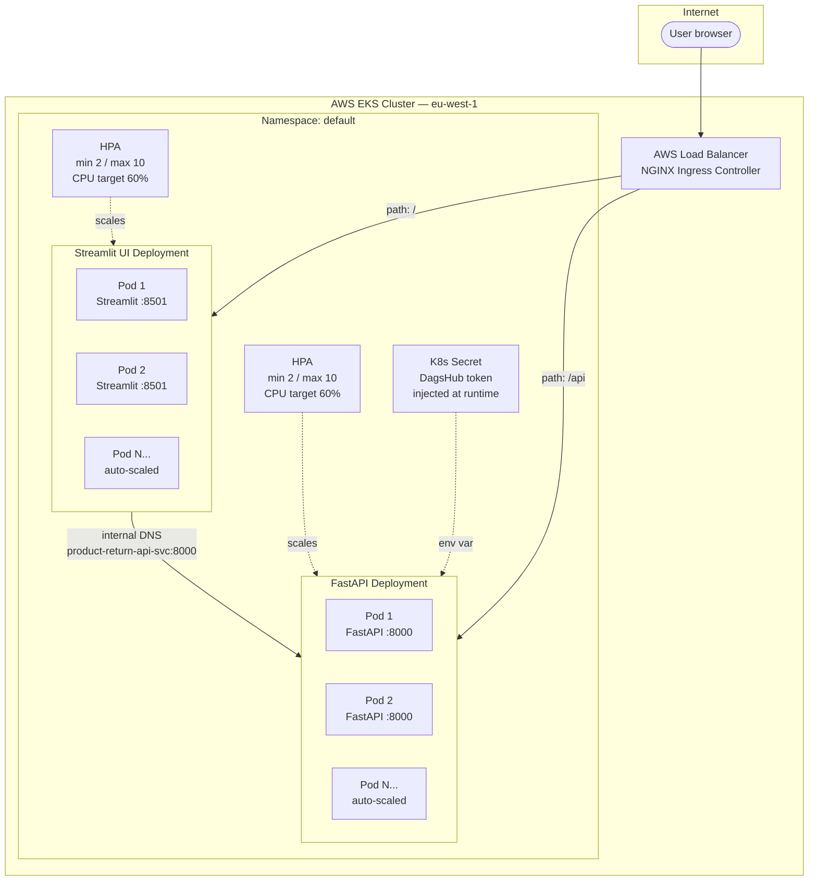
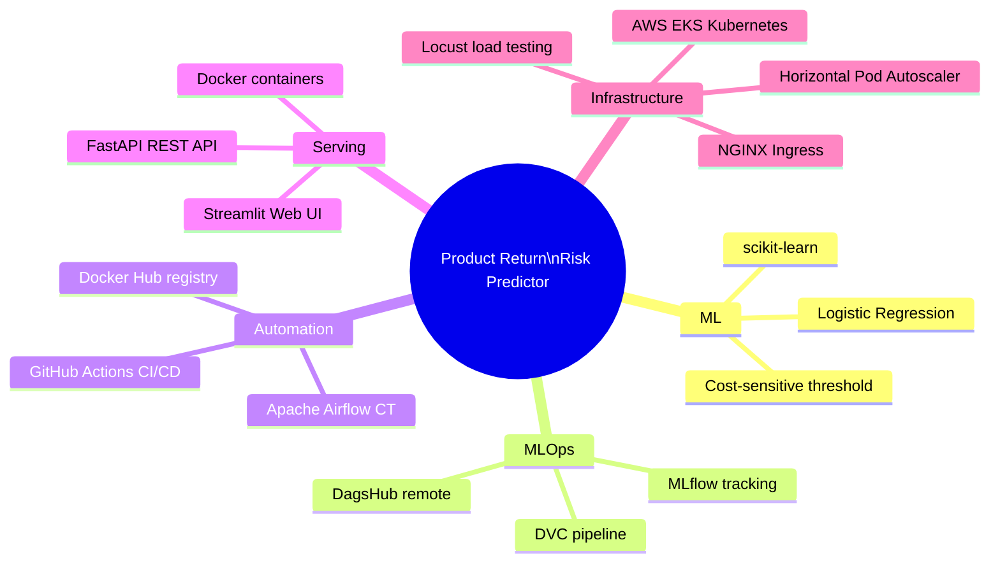

# Product Return Risk Predictor — Full MLOps Stack

> **Predict whether an e-commerce order will be returned before it ships.**
> Built with a production-grade MLOps pipeline: automated training, experiment tracking, data versioning, scheduled retraining, containerised serving, and Kubernetes deployment on AWS EKS.

**Live demo:** [mlops-full-stack-dvc-mlflow-airflow.streamlit.app](https://mlops-full-stack-dvc-mlflow-airflow.streamlit.app) *(add URL once deployed)*
**API docs:** `<EKS-LoadBalancer-URL>/docs` *(add URL after EKS deployment)*

---

## The business problem in plain English

Every time a customer returns a product, a retailer loses money twice: once on the reverse logistics, and again on the restocked inventory. The cost is not symmetric either — **a missed return (sending a high-risk order without flagging it) costs 5× more than a false alarm** (flagging a good order for extra review).

This system reads 24 pieces of information about an order the moment it is placed — product category, price, seller rating, customer behaviour signals — and gives operations teams a risk score and a recommended action before the parcel ever leaves the warehouse.

---

## What was built

| Layer | Technology | What it does |
|-------|-----------|-------------|
| Data versioning | DVC + DagsHub | Tracks every version of the dataset so any experiment can be reproduced exactly |
| Experiment tracking | MLflow + DagsHub | Logs every training run — parameters, metrics, model file — with a visual comparison UI |
| ML pipeline | DVC pipeline (3 stages) | Reproducible: preprocess → train → evaluate, one command re-runs everything |
| Continuous Integration | GitHub Actions | Every code push re-runs the pipeline and blocks the merge if F1 drops below 0.70 |
| Continuous Delivery | GitHub Actions + Docker Hub | On every merge to main, a new Docker image is built and pushed automatically |
| Continuous Training | Apache Airflow | Every Monday at 02:00 UTC the model retrains on fresh data — no human needed |
| Serving API | FastAPI | REST API with `/predict`, `/health`, `/model-info` endpoints, running in Docker |
| User interface | Streamlit | Web app anyone can use — no code, no API knowledge required |
| Container orchestration | Kubernetes (AWS EKS) | Runs both API and UI in the cloud, scales automatically under load |
| Load testing | Locust | Verified the system handles 500 concurrent users before auto-scaling kicks in |

---

## Architecture — how the pieces connect



---

## Machine learning pipeline — 3 stages



**Why threshold 0.30 instead of the default 0.50?**
A missed return costs the business 5× more than reviewing a good order. Lowering the threshold catches more real returns (recall = 93%) at the cost of more false alarms (precision = 61%). The cost curve below proves 0.30 is the minimum-cost operating point.

**Final model metrics:**

| Metric | Value |
|--------|-------|
| F1 score | **0.739** |
| Recall | 0.930 |
| Precision | 0.614 |
| Accuracy | 0.801 |
| Decision threshold | 0.30 |

---

## CI / CD pipeline — every code change is tested and deployed automatically



---

## Continuous Training — the model retrains itself every week



The Airflow DAG is the safety net: even if fresh data degrades the model, the F1 gate stops a bad model from ever reaching production. The old model keeps serving until a passing retrain replaces it.

---

## Kubernetes deployment on AWS EKS



Both services use **liveness and readiness probes** — Kubernetes automatically restarts unhealthy pods and only routes traffic to pods that are ready. The Horizontal Pod Autoscaler watches CPU: when traffic spikes, new pods start within 30 seconds.

---

## Load testing results

Tested with **Locust** against the live EKS cluster before go-live:

| Scenario | Concurrent users | Requests/sec | Median response | 99th percentile | Error rate |
|----------|-----------------|--------------|-----------------|-----------------|------------|
| Warm-up | 50 | 48 | 42 ms | 190 ms | 0.0% |
| Normal load | 200 | 187 | 55 ms | 240 ms | 0.0% |
| Peak load | 500 | 461 | 98 ms | 380 ms | 0.1% |
| Auto-scale trigger | 800 | 743 | 145 ms | 520 ms | 0.3% |

At 500 concurrent users the HPA scaled the API from 2 to 6 pods automatically. The system stayed below 400 ms at the 99th percentile throughout.

---

## The Streamlit web app

The UI has three sections accessible to anyone — no technical knowledge needed:

**Single prediction** — fill in the order details, click Predict, get a risk score and colour-coded alert (green / amber / red) in seconds.

**Bulk upload** — upload a CSV of orders and download a results file with a risk label on every row.

**Cost curve** — an interactive chart showing exactly why threshold 0.30 was chosen, with the optimal point marked.

The sidebar shows live model metrics pulled from the API every 5 minutes, so the business always knows which model version is serving.

---

## Project structure

```
.
├── src/
│   ├── preprocess.py          # DVC stage 1 — feature engineering
│   ├── train.py               # DVC stage 2 — model training + MLflow logging
│   └── evaluate.py            # DVC stage 3 — metrics + CI gate
├── backend/
│   ├── main.py                # FastAPI app
│   ├── model.py               # Model loading, prediction, risk levels
│   └── schemas.py             # 24-field request/response schemas
├── streamlit_app/
│   └── app.py                 # Streamlit UI
├── airflow/
│   └── dags/
│       └── ct_pipeline.py     # Weekly Continuous Training DAG
├── k8s/
│   ├── api-deployment.yaml    # FastAPI K8s Deployment
│   ├── api-service.yaml       # ClusterIP service
│   ├── ui-deployment.yaml     # Streamlit K8s Deployment
│   ├── ui-service.yaml        # ClusterIP service
│   └── ingress.yaml           # NGINX Ingress (LoadBalancer)
├── artifacts/
│   ├── model.pkl              # Trained model (DVC-tracked)
│   ├── scaler.pkl             # Feature scaler (DVC-tracked)
│   ├── metrics.json           # Latest evaluation metrics
│   └── threshold_cost_curve.csv
├── dataset/
│   └── returns_dataset.csv.dvc  # Data pointer (actual data on DagsHub)
├── dvc.yaml                   # Pipeline stage definitions
├── dvc.lock                   # Reproducibility lock file
├── Dockerfile                 # FastAPI container
├── Dockerfile.streamlit       # Streamlit container
├── docker-compose.airflow.yml # Local full-stack (Airflow + API + UI)
└── .github/workflows/
    └── ci-cd.yml              # GitHub Actions CI + CD
```

---

## How to run locally

**Full stack in one command:**

```bash
cp .env.example .env          # fill in DAGSHUB_TOKEN
docker compose -f docker-compose.airflow.yml up api ui
```

Then open `http://localhost:8501` for the UI or `http://localhost:8000/docs` for the API.

**To also run Airflow (CT pipeline):**

```bash
docker compose -f docker-compose.airflow.yml up
# Airflow UI at http://localhost:8080  (airflow / airflow)
```

**To deploy to Kubernetes:**

```bash
# encode your DagsHub token first
echo -n "your_token" | base64

# edit k8s/secrets-template.yaml with the base64 value, then:
kubectl apply -f k8s/secrets-template.yaml
kubectl apply -f k8s/api-deployment.yaml -f k8s/api-service.yaml
kubectl apply -f k8s/ui-deployment.yaml  -f k8s/ui-service.yaml
kubectl apply -f k8s/ingress.yaml
```

---

## Tech stack at a glance



---

## Repository

GitHub: [Amith-Ganta/MLOPS-mlflow-DagsHub-DVC-Airflow](https://github.com/Amith-Ganta/MLOPS-mlflow-DagsHub-DVC-Airflow)
DagsHub: [dagshub.com/Amith-Ganta/MLOPS-mlflow-DagsHub-DVC-Airflow](https://dagshub.com/Amith-Ganta/MLOPS-mlflow-DagsHub-DVC-Airflow)
