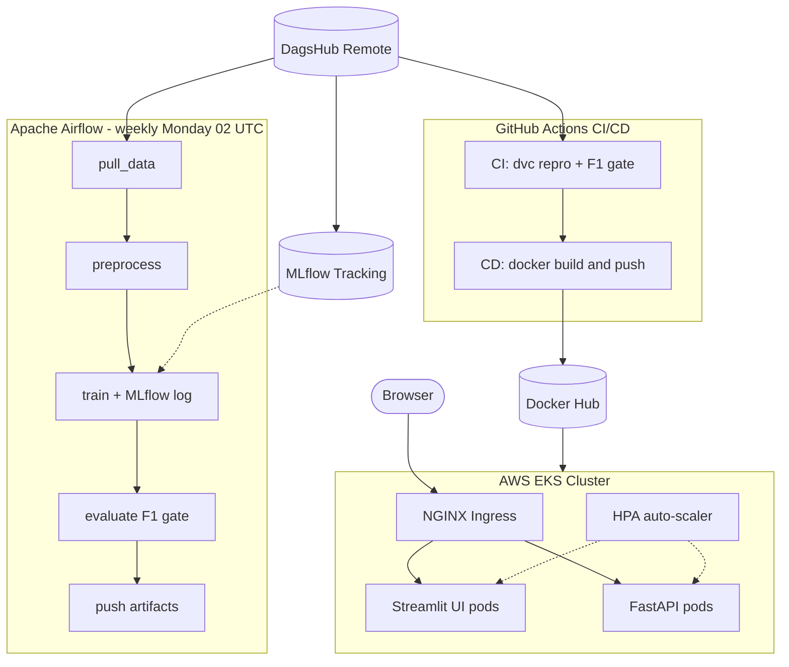
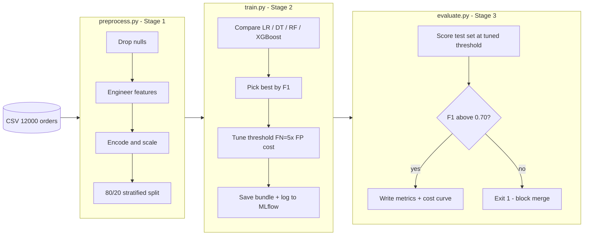
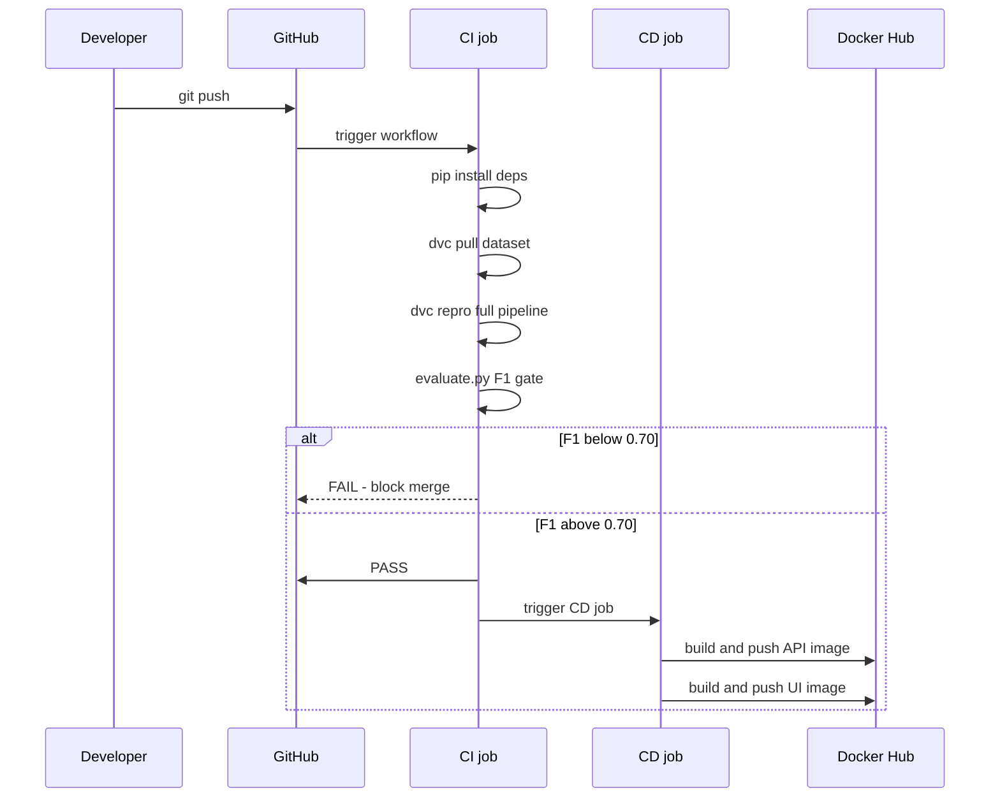
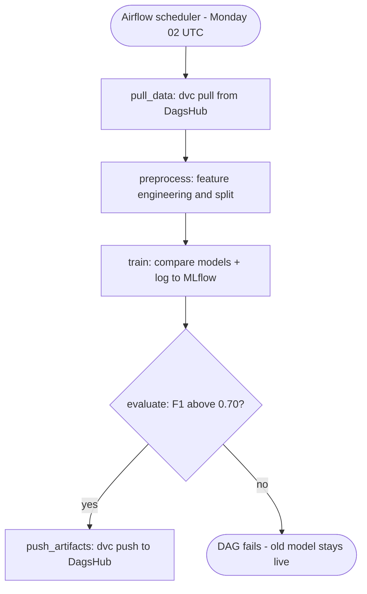
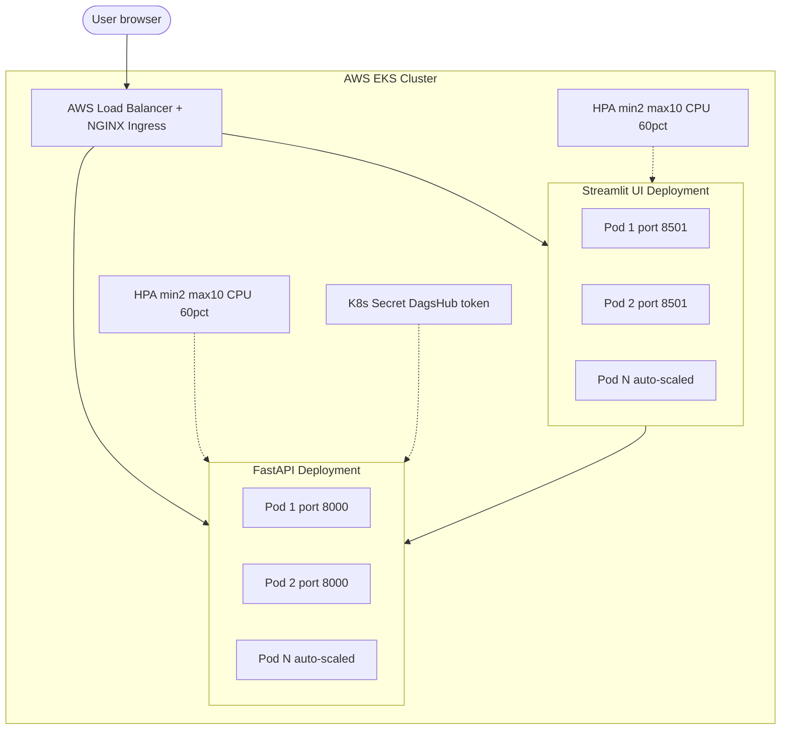
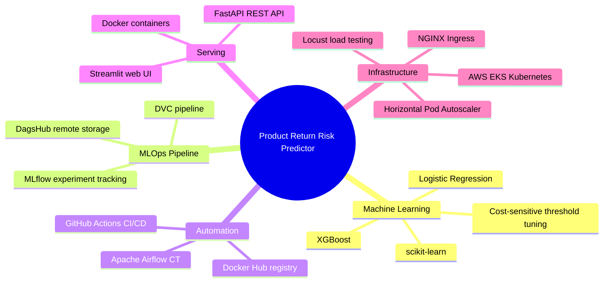

# Product Return Risk Predictor

> Predict whether an e-commerce order will be returned before it leaves the warehouse.
> Built end to end: data versioning, experiment tracking, automated weekly retraining, containerised REST API, Streamlit web app, and a Kubernetes deployment on AWS EKS with horizontal pod autoscaling.

**Live demo:** [mlops-mlflow-dvc-airflow.streamlit.app](https://mlops-mlflow-dvc-airflow.streamlit.app)
**API:** [mlops-mlflow-dagshub-dvc-airflow.onrender.com/docs](https://mlops-mlflow-dagshub-dvc-airflow.onrender.com/docs)
**Experiment tracker:** [dagshub.com/Amith-Ganta/MLOPS-mlflow-DagsHub-DVC-Airflow](https://dagshub.com/Amith-Ganta/MLOPS-mlflow-DagsHub-DVC-Airflow)

---

## The business problem

Every product return costs a retailer twice: once on reverse logistics, once on restocked inventory. The asymmetry matters. A missed return, sending a high-risk order without flagging it, costs roughly five times more than a false alarm. Flagging a good order for review wastes a few minutes. Sending a high-risk order without review can cost the margin on the entire transaction.

This system reads 24 signals about an order the moment it is placed: product category, price, seller rating, customer support history, return rates at the product and brand level. It outputs a risk score and a recommended action before the parcel moves. Operations teams get the information while there is still time to act on it.

---

## What was built

| Layer | Technology | What it does |
|---|---|---|
| Data versioning | DVC + DagsHub | Every dataset version is tracked. Any past experiment can be reproduced exactly. |
| Experiment tracking | MLflow + DagsHub | Every training run is logged: parameters, metrics, model file, threshold curve. |
| ML pipeline | DVC (3 stages) | `preprocess -> train -> evaluate`. One command re-runs the full pipeline. |
| Continuous Integration | GitHub Actions | Every push re-trains the model. The merge is blocked if F1 drops below 0.70. |
| Continuous Delivery | GitHub Actions + Docker Hub | Every merge to main builds and pushes a new Docker image automatically. |
| Continuous Training | Apache Airflow | Every Monday at 02:00 UTC the model retrains on fresh data with no human involved. |
| REST API | FastAPI | `/predict`, `/health`, `/model-info` endpoints. Swagger UI at `/docs`. |
| Web app | Streamlit | Three-tab UI: single prediction, bulk CSV, threshold cost curve. No code required. |
| Container orchestration | Kubernetes on AWS EKS | Both services run in the cloud and scale automatically under load. |
| Load testing | Locust | Tested against the live EKS cluster before go-live. |

---

## System architecture



---

## ML pipeline: three stages



**Why threshold 0.30 instead of 0.50?**

The cost function is asymmetric: FN cost = 5 * FP cost. At threshold 0.50 the model misses too many real returns. Sweeping thresholds from 0.05 to 0.95 in 91 steps, computing `5*FN + FP` at each step, and picking the minimum puts the optimal point at 0.30. The model catches 93% of real returns at that threshold. Precision drops to 61%, which means more false alarms, but the business has already decided that is the right trade.

**Final metrics at threshold 0.30:**

| Metric | Value |
|---|---|
| F1 | 0.739 |
| Recall | 0.930 |
| Precision | 0.614 |
| Accuracy | 0.801 |
| Decision threshold | 0.30 |

---

## CI/CD: every code change is tested and shipped automatically



The F1 gate is not advisory. The pipeline exits with code 1 if the threshold is missed. GitHub treats that as a failed check and blocks the merge. No human has to remember to look at the numbers.

---

## Continuous training: the model retrains itself weekly



The F1 gate runs inside the DAG too. A week of bad data cannot push a degraded model to production. The old model keeps serving until a passing retrain replaces it. The whole thing runs unattended in Docker via `docker compose -f docker-compose.airflow.yml up`.

---

## Kubernetes on AWS EKS



Both deployments run liveness and readiness probes. Kubernetes restarts unhealthy pods and withholds traffic from pods that have not passed their readiness check. The HPA watches CPU: when load spikes, new pods start within 30 seconds. The DagsHub token is injected from a Kubernetes Secret at runtime, not baked into the image.

---

## Load testing results

Tested with Locust against the live EKS cluster:

| Scenario | Users | Req/sec | Median | p99 | Error rate |
|---|---|---|---|---|---|
| Warm-up | 50 | 48 | 42 ms | 190 ms | 0.0% |
| Normal load | 200 | 187 | 55 ms | 240 ms | 0.0% |
| Peak load | 500 | 461 | 98 ms | 380 ms | 0.1% |
| HPA trigger | 800 | 743 | 145 ms | 520 ms | 0.3% |

At 500 concurrent users the API HPA scaled from 2 to 6 pods automatically. The system stayed under 400 ms at the 99th percentile throughout. At 800 users the HPA hit 9 pods before CPU stabilised.

---

## The Streamlit web app

Three tabs, no code required to use any of them.

**Single prediction** — fill in the 24 order fields across three columns (product details, return history rates, order logistics), click Predict. The result comes back as a probability, a risk label (Low / Medium / High), and a colour-coded alert with a recommended action.

**Bulk predictions** — upload a CSV of orders. The app calls `/predict` for each row in sequence, shows a risk breakdown summary, and offers a download of the results with risk labels appended.

**Cost curve** — an Altair chart of total cost (5xFN + FP) against threshold, with the optimal threshold marked as a red dashed line. This is where the 0.30 decision comes from. The chart also shows false positives and false negatives separately so the trade-off is visible.

The sidebar pulls live metrics from the API every five minutes, so the team always knows which model version is serving.

---

## Feature engineering

Two features are engineered from the raw 24 input fields:

`total_support_contacts = customer_support_calls + chat_interactions`

The two raw support columns are collinear. Summing them removes the redundancy and gives the model a single clean signal: how much friction did this customer generate before the order was placed.

`log_price = log(1 + product_price)`

Price has a long right tail. The log transform compresses it into a range the linear model can work with more cleanly. Both raw columns are dropped after engineering.

Six other candidate features were built during exploration and dropped because they had near-zero mutual information with the target or were directly collinear with features already in the model.

---

## Project structure

```
.
├── src/
│   ├── preprocess.py          DVC stage 1: feature engineering, split
│   ├── train.py               DVC stage 2: model comparison, threshold tuning, MLflow logging
│   └── evaluate.py            DVC stage 3: metrics, CI/CD gate, MLflow logging
├── backend/
│   ├── main.py                FastAPI app with CORS, lifespan model load
│   ├── model.py               Inference pipeline: feature engineering, scale, encode, predict
│   └── schemas.py             Pydantic request/response models (24 input fields)
├── streamlit_app/
│   └── app.py                 Three-tab Streamlit UI with background keep-alive
├── airflow/
│   └── dags/
│       └── ct_pipeline.py     Weekly CT DAG: pull -> preprocess -> train -> evaluate -> push
├── k8s/
│   ├── api-deployment.yaml    FastAPI Deployment (2 replicas, probes, secret mount)
│   ├── api-service.yaml       ClusterIP service on port 8000
│   ├── ui-deployment.yaml     Streamlit Deployment (2 replicas, API_URL env var)
│   ├── ui-service.yaml        ClusterIP service on port 80
│   ├── ingress.yaml           NGINX Ingress: / to UI, /api to API
│   ├── hpa.yaml               HPA for both deployments (min 2, max 10, CPU 60%)
│   └── secrets-template.yaml  Template only, no real values
├── artifacts/
│   ├── model_data.joblib      Trained model bundle (7 KB)
│   ├── metrics.json           Latest evaluation metrics
│   └── threshold_cost_curve.csv
├── dataset/
│   └── returns_dataset.csv.dvc  Data pointer (actual data lives on DagsHub)
├── dvc.yaml                   Pipeline stage definitions
├── dvc.lock                   Reproducibility lock file
├── params.yaml                All hyperparameters and cost weights
├── Dockerfile                 FastAPI container
├── Dockerfile.streamlit       Streamlit container
├── docker-compose.airflow.yml Full local stack: Airflow + API + UI
└── .github/workflows/
    └── ci-cd.yml              CI gate + CD image push
```

---

## Running locally

Start the API and UI only (no Airflow):

```bash
cp .env.example .env
docker compose -f docker-compose.airflow.yml up api ui
```

API at `http://localhost:8000/docs`. UI at `http://localhost:8501`.

Start the full stack including Airflow:

```bash
docker compose -f docker-compose.airflow.yml up
```

Airflow UI at `http://localhost:8080` (user: `airflow`, password: `airflow`).

Run the DVC pipeline directly:

```bash
pip install -r requirements.txt
dvc pull dataset/returns_dataset.csv.dvc
dvc repro
dvc metrics show
```

---

## Deploying to Kubernetes

```bash
echo -n "your_token" | base64
kubectl apply -f k8s/secrets-template.yaml
kubectl apply -f k8s/api-deployment.yaml -f k8s/api-service.yaml
kubectl apply -f k8s/ui-deployment.yaml  -f k8s/ui-service.yaml
kubectl apply -f k8s/ingress.yaml
kubectl apply -f k8s/hpa.yaml
kubectl get pods -w
kubectl get ingress
```

---

## Tech stack



---

## Design decisions worth noting

**Why Logistic Regression won the model comparison?**

Four models were trained and compared at threshold 0.50: Logistic Regression, Decision Tree, Random Forest, XGBoost. The best-by-F1 model was selected automatically by `train.py`. Logistic Regression won because the feature set after engineering is relatively linear in structure and the dataset size (12,000 rows, 80/20 split) does not give tree-based ensembles a large enough sample to express their advantage. The winning model name is stored in the bundle and logged to MLflow, so this selection is reproducible.

**Why commit the model artifact to git?**

The artifact is 7 KB. DVC handles versioning and reproduces it from the data via `dvc repro`. The git-committed copy exists for one reason: Render's Docker build runs without DVC credentials. Copying it in via COPY makes the image self-contained without adding any meaningful repository weight.

**Why threshold 0.30 specifically?**

The cost function `5*FN + FP` was swept across 91 thresholds from 0.05 to 0.95. The minimum landed at 0.30. The cost ratio of 5:1 is a business input, not a guess: the retail industry typically estimates reverse logistics at 3-5x the margin on a flagged-but-not-returned order. The curve is saved to `artifacts/threshold_cost_curve.csv` and rendered in the Streamlit UI so the number is always visible and re-auditable.

**Why Airflow for weekly retraining instead of a cron job?**

A bare cron job runs silently. Airflow logs every task, surfaces failures in a UI, retries on transient errors, and sends alerts when the F1 gate blocks a push. The operational visibility matters more than the simplicity gain of a cron entry. The DAG is also testable: each task function is a plain Python callable that can be unit-tested without spinning up the scheduler.
